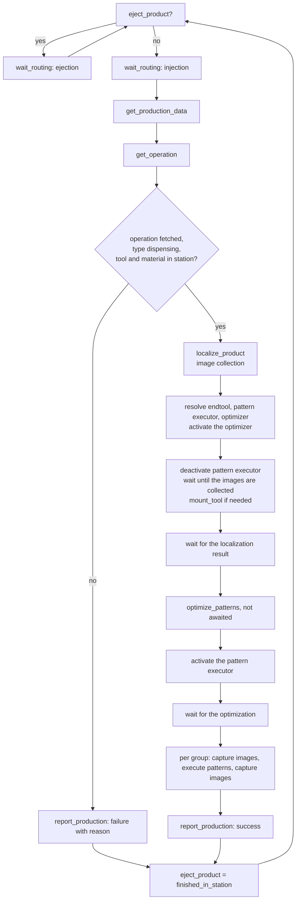

# manufacturing_executor

ROS 2 package with the lifecycle node `manufacturing_executor`. While its action `~/manufacture` runs, the node
executes the **manufacturing loop** of a station: it receives a product, fetches its operation, localizes the
product, mounts the required endtool, executes the pattern groups of the operation with images taken before and
after, reports the production result and ejects the product when the station has no more work for it.

Only operations of type `dispensing` are supported.

## Interface

All interfaces are node private (`~/...`) and exist only while the node is **active**.

### Action `~/manufacture` (`manufacturing_executor/action/Manufacture`)

```
# goal: none
---
float64 total_manufacturing_time_s
bool success
string error_message
---
# feedback: none
```

* One goal at a time; a second goal is rejected.
* The goal ends only when the caller cancels it, a system failure occurs or the node is deactivated.
* Caller cancel: `success=true`, empty `error_message` (a cancel is not a failure).
* Node side abort: `success=false` with a descriptive `error_message`.
* `total_manufacturing_time_s` is measured with the node clock (it respects `use_sim_time`) from the acceptance of
  the goal until the result is sent.

## Manufacturing loop



1. **Routing**: `wait_routing` of the station workplace (`injection`, or `ejection` when `eject_product` is set).
   An `UNKNOWN` product is a system failure.
2. **Production data**: `get_production_data` of the production manager.
3. **Operation**: `get_operation` of the operation repository.
4. **Endtool lookup** (no motion): the tool must be on the rack (`tool_rack/slots`) or mounted
   (`tool_mount/tool_mounted`) and match `end_tool` and `material` of the operation exactly (part number and
   revision). With several matches the mounted tool wins, otherwise the lowest slot index.
5. **Localization**: `localize_product` of the localizer. The robot is not moved before the localizer reports
   `collection_done`.
6. **Nodes of the tool**: the endtool node name comes from `get_tool_node_name` of the tools manager; the
   read-only parameter `pattern_executor` of the endtool names the pattern executor and the read-only parameter
   `execution_optimizer` of the executor names the optimizer. Both must be listed in the node parameters.
7. **Optimizer**: exactly one optimizer is active. If another one is active it is deactivated first. The selected
   optimizer stays active afterwards.
8. **Mount**: the pattern executor is deactivated, then `mount_tool` of the tools manager runs unless the tool is
   already mounted.
9. to 12. The localized frame is applied to the patterns, `optimize_patterns` runs while the pattern executor is
   activated, then the result is awaited.
13. **Execution** in one movement session: for every pattern group the camera is moved (PTP, `camera_tcp`) to each
    capture pose, an image is captured (`get_image`) and uploaded (`upload_image`), the patterns of the group are
    executed (`execute_dispensing_pattern`) and the images are captured again from the same poses. The session is
    closed and the pattern executor is deactivated afterwards, also on failure or cancel.
14. **Report**: `report_production` with the outcome. `finished_in_station` of the response decides whether the
    product is ejected or whether the next operation of the product follows.

### Failures

* **Operation failure**: fetching the operation fails, the operation type is not `dispensing`, or the station has
  no matching endtool/material. A failure is reported to the production manager with a reason, the product is
  ejected and the loop continues.
* **System failure**: every other failure (routing, localization, optimization, mounting, movement, camera, image
  upload, a service or action that is not available, a lifecycle transition that fails, the product leaving the
  station unexpectedly, ...). The goal ends with `success=false`; nothing is reported to production. Every failure
  is logged.

From the arrival of a product until its ejection starts, the node watches `~/workplace` of the station workplace.
If the product is gone or replaced, all running child goals are cancelled and the goal fails.

### Cancel and deactivation

On a caller cancel the node cancels the running child goals, releases the movement session, deactivates the
pattern executor and leaves the optimizer active and the product in the station. The result has `success=true`.
Deactivating the node while a goal runs ends the goal as a failure whose message names the deactivation.

## Parameters

| Name | Type | Default | Description |
|---|---|---|---|
| `camera_tcp` | string | `camera_tcp_calibrated` | TF frame used as `tool_frame` for the image capture moves. |
| `dependency_nodes.names` | string[] | all keys below | Dependency keys; parallel to `dependency_nodes.values`. |
| `dependency_nodes.values` | string[] | defaults below | Node names; same length as `.names`. |
| `execution_optimizer_nodes` | string[] | `['dispensing_optimizer']` | Optimizers this node configures and cleans up. |
| `pattern_executor_nodes` | string[] | `['dispensing_pattern_executor']` | Pattern executors this node configures and cleans up. |
| `service_call_timeout_s` | double | `5.0` | Service calls and availability checks of services and action servers. |
| `image_capture_settling_s` | double | `0.5` | Wait after each capture move before the image is taken. |
| `lifecycle_transition_timeout_s` | double | `10.0` | Lifecycle transition of another node. |
| `localization_result_timeout_s` | double | `120.0` | Wait for the localization result. |
| `optimization_timeout_s` | double | `60.0` | Wait for the pattern optimization. |
| `mount_tool_timeout_s` | double | `300.0` | Wait for `mount_tool`. |
| `image_capture_timeout_s` | double | `10.0` | `get_image` action and image upload. |
| `movement_session_timeout_s` | double | `60.0` | Requested timeout of the movement session. |

Routing, pattern execution and movements have no timeout.

`dependency_nodes` keys (every key has a default; unknown, duplicate or mismatching keys fail `configure`):

| Key | Default |
|---|---|
| `movement_controller` | `movement_controller` |
| `tools_manager` | `tools_manager` |
| `image_repository` | `image_repository` |
| `production_manager` | `production_manager` |
| `station_workplace` | `workplace_rfid_scanner` |
| `localizer` | `mock_localizer` |
| `camera` | `cameras/basler_camera` (not a lifecycle node) |
| `operation_repository` | `operation_repository` |
| `tool_rack` | `tool_rack` |
| `tool_mount` | `tool_mount` |

## Lifecycle

The node never changes its own state; an external lifecycle manager does.

| Transition | Behavior |
|---|---|
| `configure` | Reads the parameters and freezes them into the configuration. |
| `activate` | 1. Every dependency except the localizer and the camera must already be `active`. 2. The localizer (must be `unconfigured`) is configured and activated. 3. Every optimizer and pattern executor (must be `unconfigured`) is configured. 4. Subscriptions and clients are created. 5. `~/manufacture` is created. A failure rolls back only what was done. |
| `deactivate` | Aborts a running goal, deactivates and cleans up the localizer, the optimizers and the pattern executors, and destroys the interfaces. |
| `cleanup` | Drops the configuration. |
| `shutdown` | Releases everything that is still held. |

The external nodes (`movement_controller`, `tools_manager`, `tool_rack`, `tool_mount`, `image_repository`,
`operation_repository`, `production_manager`, `station_workplace`, `product_carrier`, the camera and the endtools)
must be brought to `active` before this node is activated.

## Launch

```bash
ros2 launch manufacturing_executor manufacturing_executor.launch.py
```

Starts the lifecycle node (unconfigured) and the localizer launch of the `localization` package. Launch arguments:
`node_name`, `use_sim_time`, `camera_tcp`, `movement_controller_node_name`, `station_workplace_node_name`,
`camera_node_name`, `localizer_node_name`. The node names are forwarded to the node parameters and to the localizer
launch. Optimizers, repositories, product carrier, production manager, station workplace, camera, endtools and the
tools manager are not started by this launch file; the `station` package starts them.

Typical sequence:

```bash
ros2 lifecycle set /manufacturing_executor configure
ros2 lifecycle set /manufacturing_executor activate
ros2 action send_goal /manufacturing_executor/manufacture manufacturing_executor/action/Manufacture "{}"
```

Cancel the goal (Ctrl+C of `send_goal`) to stop the loop.
